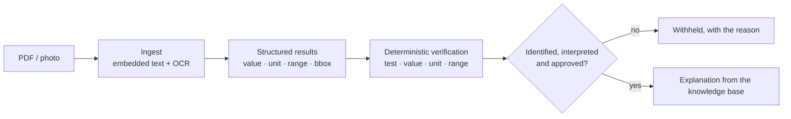

# MediRead

Privacy-first, fully on-device understanding of laboratory reports. MediRead turns a PDF or a
photo into structured results with page-level provenance, verifies every value, unit and printed
range in code, and explains the result from a versioned knowledge base.

No report data leaves the device. There is no cloud inference, no telemetry and no account.

> **Learning project.** MediRead is a self-directed engineering build, not a product. It exists
> to learn the path from a PDF to a guarded on-device explanation: OCR and table extraction,
> deterministic medical logic, knowledge gating and Android app engineering. Everything here is
> open for reading and reuse, but it is not a medical device.
>
> MediRead is an educational report-understanding tool, not a diagnostic system.
> Nothing in this repository is clinically validated.

## Highlights

- **On-device end to end** — text extraction, OCR, verification, explanations and provenance all
  run on the device.
- **Deterministic safety** — test identification, numeric interpretation, reference-range
  comparison, unit handling and field-level permissions are decided by code. Ambiguous, unknown
  or unapproved results are withheld with a reason, never guessed.
- **Verbatim provenance** — every extracted field keeps its page and bounding box, and every
  explanation states what was withheld and why.
- **Versioned knowledge** — 81 entries, 18 sources and 288 evidence records; an explanation is
  only produced for an approved entry.

## Demo

[Watch the app walkthrough](https://youtu.be/vYLK22f-utg) — import, verified extraction and
explanations.

## How it works



The gate is explicit and conservative: a result is explained only when the test was identified,
the value interpreted, the unit and range confirmed where required, and the knowledge entry's
review status is exactly `approved`. In every other case the result is flagged and shown with the
reason instead of being guessed.

## Architecture

| Layer | Where | Responsibility |
|---|---|---|
| Ingestion | `src/mediread/ingest`, `src/mediread/ocr` | Page inspection, digital/OCR/hybrid routing, reading order, extraction contract |
| Structured results | `src/mediread/structured` | Test/value/unit/range extraction with field-level status and provenance |
| Knowledge | `src/mediread/knowledge`, `knowledge/` | Versioned, reviewed entries, aliases, sources, FTS retrieval |
| Explanations | `src/mediread/explain` | Deterministic composition, per-field gates |
| Mobile app | `app/` | Flutter UI, Dart extraction and explanation pipeline |
| Tooling | `tooling/`, `scripts/`, `docker/`, `notebooks/` | Inspection, evaluation and earlier model-training/export scripts |

The complete ingestion design is documented in [`docs/architecture.md`](docs/architecture.md).

## Evaluation

### Development corpus

The deterministic pipeline was built and checked against an internal corpus of real-format
laboratory reports. The reports themselves are not in this repository (they are patient data), but
the counts below are what the pipeline and explanation layers were evaluated on.

| Stage | Result |
|---|---|
| Reports ingested | 10 unique reports / 66 pages |
| Results extracted | 325 (292 verified, 33 flagged for review — 10.1 %) |
| Explanations | 208 fully explained, 86 partially explained, 31 withheld |
| Knowledge package | 81 entries (75 draft, 6 reviewed), 18 sources, 288 evidence records |

### What this does not prove

- No clinical validation, no diagnostic accuracy claim.
- The corpus is a development check, not a broad medical benchmark.
- OCR and table extraction vary by report producer; uncertain fields are flagged rather than
  guessed.
- Timings measured on an emulator are not phone timings.

## Repository layout

```text
src/mediread/        Python engine: ingest, OCR, structured results, knowledge, explanations
app/                 Flutter application (Dart extraction and explanation pipeline)
tests/               pytest suite for the Python engine
knowledge/           versioned knowledge package
docs/architecture.md ingestion architecture (the only published document)
datasets/            versioned SFT dataset (earlier model work, not part of the app flow)
tooling/             inspection, evaluation and earlier training/export scripts
scripts/             export entry point (earlier model work)
docker/              pinned Linux export image (earlier model work)
notebooks/           export notebooks (earlier model work)
```

Patient reports, models, evaluation results and generated artifacts are gitignored.

## Getting started (Python)

Requires Python 3.11–3.12.

```bash
python3.11 -m venv .venv
.venv/bin/pip install -e ".[dev]"

# Optional OCR backends
.venv/bin/pip install pytesseract            # plus: brew install tesseract
.venv/bin/pip install rapidocr-onnxruntime
.venv/bin/pip install pyobjc-framework-Vision pyobjc-framework-Quartz   # macOS
```

Common commands:

```bash
mediread probe                                  # which OCR engines are available
mediread inspect "medical reports"              # structural inventory, no text written
mediread extract report.pdf --out artifacts/extractions
mediread results artifacts/extractions --out artifacts/results --summary
```

Point the CLI at your own PDFs; the `medical reports/` directory is local-only and never
committed.

## Running the mobile app

Requires Flutter 3.47+ and an Android device or emulator (minSdk 26).

```bash
cd app
flutter pub get
flutter test
flutter analyze
flutter build apk --release
adb install -r build/app/outputs/flutter-apk/app-release.apk
```

The app explains reports without network access; leave airplane mode on and it still works.

## Tests

```bash
.venv/bin/python -m pytest        # Python engine, contracts, gates, extraction
cd app && flutter test            # Flutter app, gates, widgets
cd app && flutter analyze
```

## Safety and privacy

- Test identification, numeric interpretation, reference-range comparison, unit conversion,
  field permissions and ambiguity handling are decided by code, not by a model.
- An explanation is only produced for an approved knowledge entry; ambiguous, unknown, draft and
  blocked results are shown with the reason.
- Every extracted field keeps its page and bounding box, so a claim can be traced back to the
  report.
- No network calls carry report data; no analytics or telemetry.
- Patient reports and derived artifacts are excluded from version control.

## Limitations

- Not a medical device and not clinically validated; explanations are educational only.
- OCR and table extraction vary by report producer; uncertain fields are flagged rather than
  guessed.
- The 10-report corpus is a development check, not a benchmark.
- Performance figures in the repository come from an emulator, not from physical phones.

## Status

The repository also contains an earlier experimental on-device model path (LoRA training, LiteRT
export and model downloads in the app). It is not part of the current explanation flow and is not
covered by this README.
