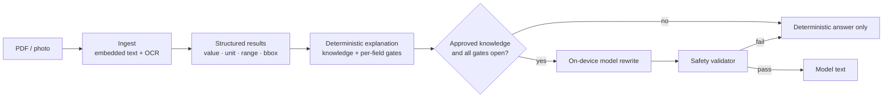

# MediRead

Privacy-first, fully on-device understanding of laboratory reports. MediRead turns a PDF or a
photo of a lab report into structured results with page-level provenance, explains them with a
deterministic engine, and optionally has a small on-device language model rewrite that
explanation in plain language — while every number, unit, range and permission stays under
deterministic control.

No report data leaves the device. There is no cloud inference, no telemetry and no account.

> MediRead is an educational report-understanding tool, not a diagnostic system.
> Nothing in this repository is clinically validated.

## Highlights

- **On-device end to end** — OCR, extraction, knowledge lookup, explanations and the optional
  model rewrite all run locally.
- **Deterministic safety** — test identification, numeric interpretation, reference-range
  comparison, unit handling, field-level permissions and knowledge approval are decided by code.
  The model only rewrites text that has already been approved.
- **Two downloadable models** — Medi Lite (~614 MB) and Medi Super (~2.39 GB), one active at a
  time, SHA-256 verified, loaded and smoke-tested before the app reports Ready.
- **Verbatim provenance** — every extracted field keeps its page and bounding box, and every
  explanation states what was withheld and why.
- **Reproducible pipeline** — versioned knowledge package, versioned SFT dataset, LoRA
  fine-tuning script and a pinned LiteRT-LM export environment.

## How it works



The gate is explicit and conservative: a result reaches the model only when the test was
identified, the value interpreted, the unit and range confirmed where required, and the
knowledge entry's review status is exactly `approved`. In every other case the deterministic
explanation is shown and no inference is run.

The validator rejects generated text that invents numbers or sources, drops the reported value or
printed range, drops the educational/not-a-diagnosis statement, or adds diagnosis, treatment or
urgency claims. A rejected generation falls back to the deterministic text.

## Architecture

| Layer | Where | Responsibility |
|---|---|---|
| Ingestion | `src/mediread/ingest`, `src/mediread/ocr` | Page inspection, digital/OCR/hybrid routing, reading order, extraction contract |
| Structured results | `src/mediread/structured` | Test/value/unit/range extraction with field-level status and provenance |
| Knowledge | `src/mediread/knowledge`, `knowledge/` | Versioned, reviewed entries, aliases, sources, FTS retrieval |
| Explanations | `src/mediread/explain` | Deterministic composition, per-field gates, model-input contract |
| Training data | `src/mediread/training`, `datasets/` | Deterministic SFT example generation, validation and splits |
| Mobile app | `app/` | Flutter UI, Dart extraction/explanation pipeline, LiteRT-LM Android bridge, model library |
| Tooling | `tooling/`, `scripts/`, `docker/`, `notebooks/` | Fine-tuning, merge, export, inspection and evaluation scripts |

The complete ingestion design is documented in [`docs/architecture.md`](docs/architecture.md).

## Models

| Product | Base model | Size | Runtime | Role |
|---|---|---|---|---|
| **Medi Lite — Compact AI** | Qwen3 0.6B | ~614 MB | LiteRT-LM 0.19.1 | Faster, smaller download |
| **Medi Super — Detailed AI** | Qwen3 0.6B FP32 | ~2.39 GB | LiteRT-LM 0.19.1 | Higher precision, more detailed rewrites |

Both are instruction-tuned from the same LoRA checkpoint. The app downloads a model only after
explicit consent, verifies its pinned SHA-256, and deletes anything that does not match. Only one
model is loaded at a time; switching releases the current engine before loading the next.

Model binaries are **not** committed. They are downloaded in the app, and their digests are pinned
in `app/lib/src/ai/model_artifact.dart`.

## Repository layout

```text
src/mediread/        Python engine: ingest, OCR, structured results, knowledge, explanations, training
app/                 Flutter application (Dart pipeline + LiteRT-LM Android bridge)
tests/               pytest suite for the Python engine
tooling/             fine-tuning, merge, export, inspection and evaluation scripts
datasets/            versioned SFT dataset (mediread-sft-v0)
knowledge/           versioned knowledge package
docs/architecture.md ingestion architecture (the only published document)
notebooks/           LiteRT-LM export notebooks (Colab and Kaggle)
scripts/             export entry point
docker/              pinned Linux export image
```

Patient reports, local models, evaluation results and generated artifacts are gitignored.

## Getting started (Python)

Requires Python 3.11–3.12.

```bash
python3.11 -m venv .venv
.venv/bin/pip install -e ".[dev]"

# Optional OCR backends
.venv/bin/pip install pytesseract            # plus: brew install tesseract
.venv/bin/pip install rapidocr-onnxruntime
.venv/bin/pip install pyobjc-framework-Vision pyobjc-framework-Quartz   # macOS
```

Common commands:

```bash
mediread probe                                  # which OCR engines are available
mediread inspect "medical reports"              # structural inventory, no text written
mediread extract report.pdf --out artifacts/extractions
mediread results artifacts/extractions --out artifacts/results --summary
```

Point the CLI at your own PDFs; the `medical reports/` directory is local-only and never
committed.

## Running the mobile app

Requires Flutter 3.47+ and an Android device or emulator (minSdk 26).

```bash
cd app
flutter pub get
flutter test
flutter analyze
flutter build apk --release
adb install -r build/app/outputs/flutter-apk/app-release.apk
```

On the device, open **Settings → On-device AI**, download a model, then activate it. Activation
shows its live state (checking → loading → test prompt → Ready); once active, everything works
offline, including airplane mode.

## Fine-tuning

The model is a LoRA adapter on [`Qwen/Qwen3-0.6B`](https://huggingface.co/Qwen/Qwen3-0.6B),
trained on the deterministic SFT set in `datasets/mediread-sft-v0`.

### Dataset

`mediread-sft-v0` is generated by `src/mediread/training` from the knowledge package and the
explanation templates — no teacher model is used. The committed splits (train / validation /
test) and the dataset card are the exact files used for training.

### Train

```bash
pip install torch transformers peft
python tooling/train_lora.py --smoke        # 4 steps, sanity check
python tooling/train_lora.py                # 2 epochs, LoRA r=8, alpha=16
```

Key options: `--epochs`, `--rank`, `--alpha`, `--dropout`, `--lr`, `--max-len`, `--batch`,
`--grad-accum`, `--seed`. Checkpoints are selected by validation loss. Outputs land in
`artifacts/training/lora-qwen3-0.6b/` (gitignored).

### Merge

```bash
python tooling/merge_lora.py                # adapter -> merged-fp16 checkpoint
```

### Export to LiteRT-LM

The export runs in Linux because the converter and TensorFlow conflict on macOS.

```bash
docker build -f docker/Dockerfile.export -t mediread-export .
docker run --rm -v "$PWD:/work" -w /work mediread-export \
  bash scripts/export_litertlm.sh
```

That script produces a quantized bundle. For the full-precision artifact used by **Medi Super**:

```bash
python -m litert_torch.generative.export_hf \
  --model=artifacts/training/lora-qwen3-0.6b/merged-fp16 \
  --litert_lm_llm_metadata_override=.cache/litertlm/LlmMetadataProto.pbtext \
  --quantization_recipe=none --model_dtype=float32 \
  --output_dir=artifacts/litertlm/qwen3-0.6b-fp32
```

`tooling/quantize_bundle.py` can re-quantize an existing bundle without re-exporting.
`notebooks/` contains the Colab and Kaggle equivalents of the export environment.

## Tests

```bash
.venv/bin/python -m pytest        # Python engine, contracts, gates, training data
cd app && flutter test            # Flutter app, model library, safety gates, widgets
cd app && flutter analyze
```

## Safety and privacy

- Knowledge reaches the model only when its review status is exactly `approved`; draft, reviewed,
  ambiguous, unknown and blocked results never invoke inference.
- The deterministic engine owns test identification, numeric interpretation, reference-range
  comparison, unit conversion, field permissions and ambiguity handling.
- Generated text is validated for invented numbers, unapproved sources, dropped values/ranges,
  missing limitations and prohibited diagnosis/treatment/urgency claims.
- A deterministic explanation is always available; the model is optional.
- Model files are downloaded on consent and verified by SHA-256 before use. Unverified bytes are
  deleted, never loaded.
- No network calls carry report data; no analytics or telemetry.
- Patient reports and derived artifacts are excluded from version control.

## Limitations

- Not a medical device and not clinically validated; explanations are educational only.
- A 0.6B model bounds rewrite quality. Every output is validated, and bad generations fall back.
- OCR and table extraction vary by report producer; uncertain fields are flagged rather than
  guessed.
- Medi Super needs ~2.39 GB of free storage and is noticeably slower on low-end CPUs.
- Performance figures in the repository come from an emulator, not from physical phones.
